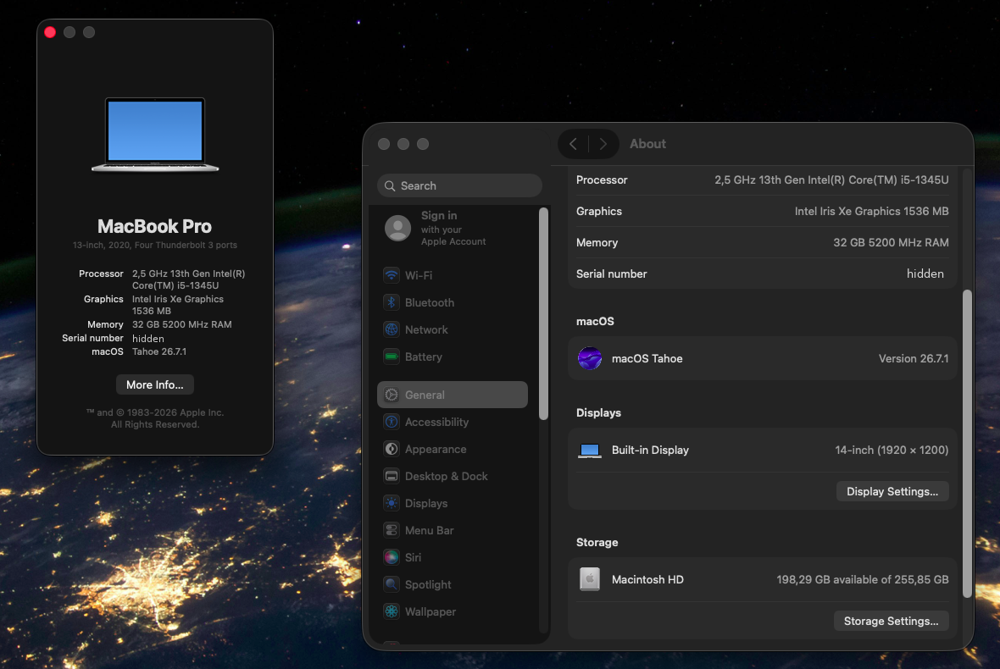
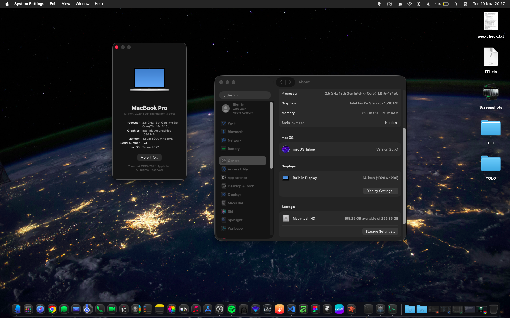

# ThinkPad T14 Gen 4 (Intel) Hackintosh: macOS Tahoe 26.7.1

OpenCore EFI for the **Lenovo ThinkPad T14 Gen 4 (Intel, 13th gen)** running **macOS Tahoe 26.7.1 (25G241)** with
**Metal acceleration on the Intel Iris Xe** (Raptor Lake-U, `8086:A7A1`) through NootedGreen.

> [!WARNING]
> Experimental. The graphics stack is a patched Tiger Lake driver running on Raptor Lake. Expect occasional stutters,
> and keep a backup EFI on a USB stick. **Only build 25G241 is supported. Do not update macOS.**



<details>
<summary>Full desktop screenshot</summary>



</details>

---

## Hardware

| Component | Model |
|---|---|
| Laptop | Lenovo ThinkPad T14 Gen 4 (Intel) |
| RAM | 32 GB DDR5-5200 |
| CPU | Intel Core i5-1345U (Raptor Lake-U, 2P + 8E, 12 threads) |
| iGPU | Intel Iris Xe, 80 EU, `8086:A7A1`, spoofed as Tiger Lake `9A49` |
| Display | 14" 1920×1200 eDP |
| Audio | Realtek ALC (layout-id 11) |
| Wi-Fi / BT | Intel AX211 (CNVi `51F1`) / Intel BT `8087:0033` |
| Touchpad | Synaptics I2C-HID (`TPD0`), GPIO interrupt mode |
| TrackPoint / keyboard | PS/2 |
| Storage | NVMe SSD |
| Battery | 52.5 Wh |

## Status

### Working
- [x] **Metal / Core Animation acceleration** (Liquid Glass, animations)
- [x] **Hardware video decode** H.264 + HEVC for VideoToolbox apps (QuickTime, Photos, Chrome) with `-ngreengva` + patched VA plugin
- [x] Internal display, brightness keys
- [x] All 12 CPU threads, power management with live EPP control (`debug.xepm.epp`)
- [x] Audio: speakers, headphone jack
- [x] Wi-Fi (itlwm + HeliPort), Bluetooth
- [x] Touchpad with gestures (VoodooI2C, **interrupt mode**, not polling), TrackPoint, keyboard
- [x] USB-A ports (USB 2 + USB 3), mapped with USBMap
- [x] Webcam, battery status, NVMe

### Not working / limitations
- [ ] **System sleep**: the firmware is Modern Standby only (no S3), so sleep is disabled. Lid close turns the display off.
- [ ] **Hardware video encode**: not available on Raptor Lake yet (upstream research paused)
- [ ] **Safari hardware decode**: Safari's sandbox blocks the patched VA plugin, so Safari decodes on the CPU
- [ ] **VP9 / AV1 hardware decode**
- [ ] **FairPlay** (Apple Music, Apple TV+) does not play while `-ngreengva` is on
- [ ] **AirDrop / AirPlay receiver / Continuity**: Intel CNVi Wi-Fi, can't be swapped for Broadcom
- [ ] **Fingerprint / Touch ID**
- [ ] **Fan RPM reading** (YogaSMC reports 0)
- [ ] **Display power saving (PSR / DC states)**: disabled by NootedGreen, costs some idle power
- [ ] **Thunderbolt 4 / USB-C as USB**: untested, not in the USB map (charging works)
- [ ] **macOS updates past 25G241**: the patches are byte-specific to this build

## Power and battery (measured)

| Scenario | Draw |
|---|---|
| Idle, CPU package (xe-temp) | ~2.3 W (cores ~0.4 W) |
| Idle, whole laptop (`ioreg`) | ~9.5 W (brightness-dependent) |
| YouTube in **Safari** (CPU decode) | ~12 W |
| YouTube in **Chrome** (GPU decode via VA plugin) | ~22 W |
| Active use peaks | ~21 W |

**Use Safari for YouTube.** On this setup the patched GPU decode path in Chrome costs more power than Safari's
software decode. Expect about 3.5–5 hours of light use.

## Boot arguments

```
keepsyms=1 -ngreentglwithgfx -allow3d -disablegfxfirmware ngreen-dmc=adlp -ngreenv189 -ngreenkeepefi
-ngreenxefix -ngreenfixbootmode amfi_get_out_of_my_way=1 ngreenSched=4 ngreenV142=3 ngreen-eu=80 ngreen-l3=6
gfxrst=1 -ngreenpm ngreenpmepp=192 -ngreengva alcid=11 -alcbeta
```

| Argument | Purpose |
|---|---|
| `ngreen-eu=80 ngreen-l3=6` | **Required for 80 EU chips** (i5-1345U, i5-1335U, i5-1340P…). Remove on 96 EU chips (i7-1355U, i7-1365U…). |
| `ngreen-dmc=adlp` | Loads the Alder Lake-P display firmware (also used by Raptor Lake) |
| `-ngreenpm` | NootedGreen power profile (HWP for hybrid cores, C8/C10, D3) |
| `ngreenpmepp=192` | CPU Energy Performance Preference: 0 = max performance, 128 = balanced, 192 = power saving, 255 = minimum. Change live with `sudo sysctl -w debug.xepm.epp=N`. |
| `-ngreengva` | Hardware video decode (needs the VA plugin, see below). Remove it for Apple Music / FairPlay. |
| `amfi_get_out_of_my_way=1` | Required by the patched user-space graphics stack |
| `alcid=11 -alcbeta` | AppleALC layout for the Realtek codec on Tahoe |

Removed from the original config for daily use: `-v` (verbose boot), `IGLogLevel=3` (GPU debug logging), and `sbvmm`
from `revpatch` (stops Software Update from offering builds that break acceleration).

## Kexts

| Kext | Version | Purpose |
|---|---|---|
| Lilu | 1.7.3 | Patching framework |
| VirtualSMC + SMCBatteryManager + SMCProcessor | 1.3.9 | SMC emulation, battery |
| ECEnabler | 1.0.6 | ThinkPad EC battery fields |
| YogaSMC | 1.5.3 | ThinkPad Fn keys and sensors |
| WhateverGreen | 1.7.2 | Display helpers (runs in NootedGreen's coexist mode) |
| **NootedGreen** | 1.0.0 | **Iris Xe acceleration** (Tiger Lake driver on Raptor Lake) |
| CpuTopologyRebuild | 2.0.2 | Hybrid P/E-core topology |
| RestrictEvents | 1.1.7 | CPU name, misc patches |
| NVMeFix | 1.1.4 | NVMe power management |
| AppleALC + SimpleHDA | 1.9.8 / 1.0.0 | Audio on Tahoe |
| BrightnessKeys | 1.0.4 | Brightness Fn keys |
| VoodooPS2Controller | 2.3.8 | Keyboard, TrackPoint |
| VoodooI2C + VoodooI2CHID (+ patched VoodooGPIO) | 2.9.1 | Touchpad, GPIO interrupt mode |
| **USBMap** | (generated) | USB port map for this laptop |
| XHCI-unsupported | 0.9.2 | PCH XHCI `8086:51ED` |
| itlwm | 2.3.0 | Intel Wi-Fi (use with HeliPort) |
| AirportItlwm | 2.4.0-alpha | **Disabled.** Native Wi-Fi menu, but fails on many networks. Never enable together with itlwm. |
| IntelBluetoothFirmware + IntelBTPatcher + BlueToolFixup | 2.5.1 / 2.7.3 | Bluetooth |

## ACPI

| SSDT | Purpose |
|---|---|
| `SSDT-PLUG-ALT` | CPU objects as `Processor()` for Alder/Raptor Lake |
| `SSDT-XOSI` | Windows `_OSI` emulation (enables the I2C touchpad paths), with `_OSI → XOSI` rename |
| `SSDT-T14G4` | USBX, AWAC → RTC, MCHC, SBUS/BUS0, PNLF. Path-guarded, macOS only |
| `SSDT-USB-Reset` | Resets RHUB so the USB map applies |

## USB map

Mapped with [USBMap](https://github.com/corpnewt/USBMap) (7 ports on `XHCI@14`):

| Port | Address | Type | Device |
|---|---|---|---|
| HS01 | `14100000` | 3 | USB-A port A (USB 2 half) |
| HS07 | `14700000` | 3 | USB-A port B (USB 2 half) |
| SS01 | `14d00000` | 3 | USB-A port A (USB 3 half) |
| SS02 | `14e00000` | 3 | USB-A port B (USB 3 half) |
| HS03 | `14300000` | 255 | Fingerprint reader (Goodix) |
| HS04 | `14400000` | 255 | Webcam |
| HS10 | `14a00000` | 255 | Bluetooth |

The Thunderbolt controller (`TXHC`) is left out of the map.

## Installation

### 1. BIOS
- Secure Boot: **off**
- Everything else default (UEFI only)

### 2. Before booting
- **Generate your own SMBIOS** (`MacBookPro16,2`) with [GenSMBIOS](https://github.com/corpnewt/GenSMBIOS) and fill
  `PlatformInfo > Generic` (`SystemSerialNumber`, `MLB`, `SystemUUID`, `ROM`). The fields in this repo are blank.
- If your CPU has **96 EU**, remove `ngreen-eu=80 ngreen-l3=6`.
- If your USB layout differs, make your own USBMap.kext.

### 3. Install macOS
Install **macOS Tahoe 26.7.1 (25G241)** exactly. Don't install any other build.

### 4. Graphics stack (after first boot)
Follow the accelerated-stack steps from
[JulioNectar/Hackintosh-XPS13Plus-IrisXe-Tahoe](https://github.com/JulioNectar/Hackintosh-XPS13Plus-IrisXe-Tahoe)
(`install.sh`): it builds and installs NootedGreen, the patched Metal driver, `libxedrv` and the shader compiler.

### 5. Hardware video decode (optional)
```sh
git clone https://github.com/sgiammori/NootedGreen.git ~/NootedGreen
git clone https://github.com/JulioNectar/Hackintosh-XPS13Plus-IrisXe-Tahoe ~/xps
cd ~/xps
zsh macos/vadriver/build-vadriver.sh ~/NootedGreen/sle_Internal/sle
sudo rm -rf /Library/GPUBundles/AppleIntelTGLGraphicsVADriver.bundle
sudo ditto ~/xps/macos/out/AppleIntelTGLGraphicsVADriver.bundle /Library/GPUBundles/AppleIntelTGLGraphicsVADriver.bundle
```
Then add `-ngreengva` to boot-args and reboot. **Install the plugin before adding the boot-arg**, otherwise video
playback breaks. Verify:
```sh
ioreg -l | grep -E "IOGVAHEVCDecode|IOVARendererID"   # expect "2" and 17301632
```

### 6. Recommended post-install
```sh
# Disable system sleep (no S3 on this laptop); lid close = display off
sudo zsh ~/xps/tools/sleep/10-pmset-safe.sh

# CPU temperatures and package/CPU/GPU watts in the menu bar
zsh ~/xps/tools/xe-temp/build.sh && cp -R ~/xps/tools/build/xe-temp.app ~/Applications/

# Resolution / HiDPI: use xe-res, NOT System Settings > Displays
clang -O2 -o ~/xps/tools/build/xe-res ~/xps/tools/xe-res.c -framework CoreGraphics -framework CoreFoundation
```
- **System Settings > Accessibility > Display > Reduce Transparency**, and **Motion > Reduce Motion**: optional. They
  cut GPU work and heat during active use; idle power is low either way.
- **Software Update**: turn off automatic updates.
- **Wi-Fi**: use HeliPort with itlwm.

## Useful commands

```sh
sysctl debug.xepm                                   # power profile status (EPP, C-states, D3)
sudo sysctl -w debug.xepm.epp=128                   # change EPP live
ioreg -rn AppleSmartBattery | grep -E '"(InstantAmperage|Voltage)"'   # live battery draw
ioreg -lw0 -r -c VoodooI2CDeviceNub | grep -i "Interrupt Mode"        # touchpad: GPIO = interrupts
```

## Credits

- [JulioNectar/Hackintosh-XPS13Plus-IrisXe-Tahoe](https://github.com/JulioNectar/Hackintosh-XPS13Plus-IrisXe-Tahoe): Raptor Lake Iris Xe acceleration stack, NootedGreen fork, VA plugin, tools
- [dssoftx/Hackintosh-X1Carbon-G11-IrisXe-Tahoe](https://github.com/dssoftx/Hackintosh-X1Carbon-G11-IrisXe-Tahoe): ThinkPad Raptor Lake-U port
- [sgiammori/NootedGreen](https://github.com/sgiammori/NootedGreen): NootedGreen
- [Acidanthera](https://github.com/acidanthera): OpenCore, Lilu, VirtualSMC, WhateverGreen, AppleALC, NVMeFix, RestrictEvents, VoodooPS2
- [VoodooI2C](https://github.com/VoodooI2C/VoodooI2C), [OpenIntelWireless](https://github.com/OpenIntelWireless), [zhen-zen/YogaSMC](https://github.com/zhen-zen/YogaSMC), [1Revenger1/ECEnabler](https://github.com/1Revenger1/ECEnabler), [corpnewt](https://github.com/corpnewt) (USBMap, ProperTree, GenSMBIOS)
- [Dortania OpenCore Install Guide](https://dortania.github.io/OpenCore-Install-Guide/)

## Disclaimer

For educational purposes. You're responsible for your own hardware and data. Apple's driver binaries are not
redistributed here; the graphics stack is built from the linked projects on your own machine.
