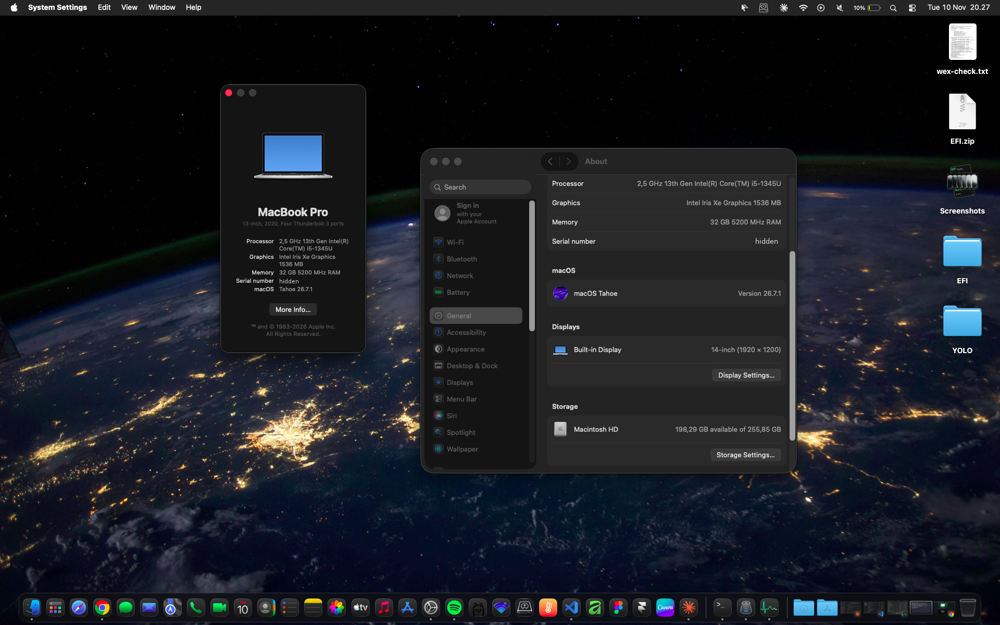

# ThinkPad T14 Gen 4 (Intel) Hackintosh: macOS Tahoe 26.7.1

OpenCore EFI for the **Lenovo ThinkPad T14 Gen 4 (Intel, 13th gen)** running **macOS Tahoe 26.7.1 (25G241)** with
**native Metal acceleration on the Intel Iris Xe** (Raptor Lake-U, `8086:A7A1`) through
[WhateverXe](https://github.com/b00t0x/WhateverXe).

> [!WARNING]
> Experimental. Keep a backup EFI on a USB stick. Tested on build **25G241** only.
>
> The previous NootedGreen-based EFI is kept at the tag
> [`nootedgreen-final`](https://github.com/chxnathanaels/T14g4-hackintosh/tree/nootedgreen-final).



---

## Hardware

| Component | Model |
|---|---|
| Laptop | Lenovo ThinkPad T14 Gen 4 (Intel) |
| RAM | 32 GB DDR5-5200 |
| CPU | Intel Core i5-1345U (Raptor Lake-U, 2P + 8E, 12 threads) |
| iGPU | Intel Iris Xe, 80 EU, `8086:A7A1` (native ID, no spoof) |
| Display | 14" 1920×1200 eDP, Innolux N140JCA-EEL |
| Audio | Realtek ALC (layout-id 11) |
| Wi-Fi / BT | Intel AX211 (CNVi `51F1`) / Intel BT `8087:0033` |
| Touchpad | Synaptics I2C-HID (`TPD0`), GPIO interrupt mode |
| TrackPoint / keyboard | PS/2 |
| Storage | NVMe SSD |
| SMBIOS | `MacBookPro16,2` |

## Status

### Working
- [x] **Metal acceleration** (1536 MB VRAM): smooth UI, Liquid Glass and transparency with no lag
- [x] Internal display at native 1920×1200 (scaled resolutions work in System Settings)
- [x] Brightness keys, with an optional smooth brightness ramp (`wexblsmooth=1`)
- [x] All 12 CPU threads
- [x] Audio: speakers, headphone jack
- [x] Wi-Fi (itlwm + HeliPort), Bluetooth
- [x] Touchpad with gestures (VoodooI2C, interrupt mode), TrackPoint, keyboard
- [x] USB-A ports (USB 2 + USB 3), mapped with USBMap
- [x] Webcam, battery status, NVMe

### Experimental
- [~] **Sleep (S0 Deep Idle)**: the firmware is Modern Standby only (no S3). With `SSDT-DeepIdle` + `SSDT-LIDWAKE`
  the laptop enters Deep Idle and resumes with the display back. Known issue: it can wake again a few seconds later
  ("due to LID", from EC events), and the power LED blinks fast because macOS doesn't put the EC into standby.
  If you don't want this, disable both SSDTs and run `sudo pmset -a disablesleep 1`.

### Not working / limitations
- [ ] **HDMI**: the port is detected but gives no picture, and the cursor can stutter while a cable is connected.
  Unplug HDMI for now.
- [ ] **CPU hybrid scheduling**: no Intel Thread Director; macOS treats P- and E-cores the same
- [ ] **AirDrop / AirPlay receiver / Continuity**: Intel CNVi Wi-Fi, can't be swapped for Broadcom
- [ ] **Fingerprint / Touch ID**
- [ ] **Thunderbolt 4 / USB-C as USB**: untested, not in the USB map (charging works)

## The panel fix (`wexpaneltype=0`)

Stock WhateverXe 0.8.3 doesn't light this panel. Lenovo's VBT sets the panel type to `0xFF` ("pick by PnP ID"), but
the PnP table doesn't contain this panel's ID and the 16 panel profiles disagree, so WEX marks the panel invalid.

The `WhateverXe.kext` in this repo is 0.8.3 with a small patch that adds the boot-arg `wexpaneltype=N`, which forces
VBT panel profile `N` when the VBT says `0xFF`. Profile 0 is correct for this laptop. Source and CI build:
[`wex-083-t14` branch](https://github.com/chxnathanaels/T14g4-hackintosh/tree/wex-083-t14).

The same build also contains:
- **Deep Idle wake fix** (on by default): saves and restores the GPU command-stream state across sleep, so resume
  doesn't panic. Disable with `-wexwakeresync-off`.
- **Smooth brightness** (off by default): `wexblsmooth=1`, tune with `wexblsteps=` (default 24) and `wexblint=`
  (ms per step, default 6).

## Boot arguments

```
keepsyms=1 alcid=11 -alcbeta -v -allow3d -disablegfxfirmware -igfxdvmt wexpaneltype=0 acpi=0xC
```

| Argument | Purpose |
|---|---|
| `-allow3d -disablegfxfirmware` | Required by WhateverXe |
| `-igfxdvmt` | WEX DVMT handling (with `framebuffer-stolenmem` in DeviceProperties) |
| `wexpaneltype=0` | **Required on this laptop**: selects VBT panel profile 0 (see above) |
| `acpi=0xC` | Lets macOS use the S0 low-power idle path for Deep Idle |
| `alcid=11 -alcbeta` | AppleALC layout for the Realtek codec on Tahoe |
| `-v keepsyms=1` | Verbose boot and readable panic logs. Remove `-v` once everything works. |

`csr-active-config` is `130A0000` (`0xA13`).

## Kexts

| Kext | Version | Purpose |
|---|---|---|
| Lilu | 1.7.3 | Patching framework |
| AMFIAnchor + AMFIAnchorInjector | 0.1.2 | Lets the WhateverXe Graphics package load (b00t0x) |
| **WhateverXe** | 0.8.3 + T14 patch | **Iris Xe acceleration and display** |
| VirtualSMC + SMCBatteryManager + SMCProcessor | 1.3.9 | SMC emulation, battery |
| ECEnabler | 1.0.6 | ThinkPad EC battery fields |
| YogaSMC | 1.5.3 | ThinkPad Fn keys and sensors |
| CpuTopologyRebuild | 2.0.2 | Hybrid P/E-core topology |
| RestrictEvents | 1.1.7 | CPU name, misc patches |
| NVMeFix | 1.1.4 | NVMe power management |
| AppleALC + SimpleHDA | 1.9.8 / 1.0.0 | Audio on Tahoe |
| BrightnessKeys | 1.0.4 | Brightness Fn keys |
| VoodooPS2Controller | 2.3.8 | Keyboard, TrackPoint |
| VoodooI2C + VoodooI2CHID | 2.9.1 | Touchpad, GPIO interrupt mode |
| **USBMap** | (generated) | USB port map for this laptop |
| XHCI-unsupported | 0.9.2 | PCH XHCI `8086:51ED` |
| itlwm | 2.3.0 | Intel Wi-Fi (use with HeliPort) |
| AirportItlwm | 2.4.0-alpha | **Disabled.** Native Wi-Fi menu. Never enable together with itlwm. If it won't join your network, set the router to WPA2-AES instead of WPA/WPA2 mixed. |
| IntelBluetoothFirmware + IntelBTPatcher + BlueToolFixup | 2.5.1 / 2.7.3 | Bluetooth |

WhateverGreen is not used: it must not be loaded together with WhateverXe.

## ACPI

| SSDT | Purpose |
|---|---|
| `SSDT-PLUG-ALT` | CPU objects as `Processor()` for Alder/Raptor Lake |
| `SSDT-XOSI` | Windows `_OSI` emulation (enables the I2C touchpad paths), with `_OSI → XOSI` rename |
| `SSDT-T14G4` | USBX, AWAC → RTC, SBUS/BUS0, PNLF, EC byte access for YogaSMC. Path-guarded, macOS only |
| `SSDT-USB-Reset` | Resets RHUB so the USB map applies |
| `SSDT-DeepIdle` | **Experimental.** `\_SB.LPS0` + `\_GPE.LXEN` for S0 Deep Idle (macOS only) |
| `SSDT-LIDWAKE` | **Experimental.** Lid wake through the EC GPE `0x6E` |

Sources are in `EFI/OC/ACPI/src`.

## USB map

Mapped with [USBMap](https://github.com/corpnewt/USBMap) (7 ports on `XHCI@14`):

| Port | Address | Type | Device |
|---|---|---|---|
| HS01 | `14100000` | 3 | USB-A port A (USB 2 half) |
| HS07 | `14700000` | 3 | USB-A port B (USB 2 half) |
| SS01 | `14d00000` | 3 | USB-A port A (USB 3 half) |
| SS02 | `14e00000` | 3 | USB-A port B (USB 3 half) |
| HS03 | `14300000` | 255 | Fingerprint reader (Goodix) |
| HS04 | `14400000` | 255 | Webcam |
| HS10 | `14a00000` | 255 | Bluetooth |

The Thunderbolt controller (`TXHC`) is left out of the map.

## Installation

### 1. BIOS
- Secure Boot: **off**
- Everything else default (UEFI only)

### 2. Before booting
- **Generate your own SMBIOS** (`MacBookPro16,2`) with [GenSMBIOS](https://github.com/corpnewt/GenSMBIOS) and fill
  `PlatformInfo > Generic` (`SystemSerialNumber`, `MLB`, `SystemUUID`, `ROM`). The fields in this repo are blank.
- If your USB layout differs, make your own USBMap.kext.

### 3. Install macOS
Install **macOS Tahoe 26.7.1 (25G241)**. For the installer and first boot, use `config-safe.plist` (rename it to
`config.plist`): it disables WhateverXe, AMFIAnchor and the Deep Idle SSDTs and boots without graphics acceleration.

### 4. Graphics
1. Boot with the main `config.plist`.
2. Install the latest [WhateverXe Graphics pkg](https://github.com/b00t0x/WhateverXe-Graphics/releases) that matches
   WhateverXe 0.8.3 (tested with Graphics 0.4.4), then restart.
3. Check:
   ```sh
   system_profiler SPDisplaysDataType | grep -E "Metal|VRAM|Resolution"   # expect Metal support and 1536 MB
   ```

The Graphics package contains Apple driver binaries and is not redistributed here.

If you used the NootedGreen stack before, remove it first (restore the original System files / AuxKC) as described
in the WhateverXe README.

### 5. Recommended post-install
- **Software Update**: turn off automatic updates.
- **Wi-Fi**: use HeliPort with itlwm.
- **Sleep**: see [Experimental](#experimental). If you keep sleep enabled, check `pmset -g log | grep -E "Sleep|Wake"`
  after a test.

## Useful commands

```sh
ioreg -lw0 | grep -E "WEXDisplay13BootReady|N97NativeStartAllowed"     # WEX display state, expect Yes
ioreg -lw0 | grep -E "T14WakeHookReady|T14WakeResync"                 # Deep Idle wake fix state
ioreg -rn AppleSmartBattery | grep -E '"(InstantAmperage|Voltage)"'   # live battery draw
ioreg -lw0 -r -c VoodooI2CDeviceNub | grep -i "Interrupt Mode"        # touchpad: GPIO = interrupts
```

## Credits

- [b00t0x/WhateverXe](https://github.com/b00t0x/WhateverXe) and
  [WhateverXe-Graphics](https://github.com/b00t0x/WhateverXe-Graphics): Iris Xe acceleration, AMFIAnchor
- [rodgod-rr/Dell-G15-5530-Hackintosh](https://github.com/rodgod-rr/Dell-G15-5530-Hackintosh): reference for the
  Deep Idle sleep and GPU wake handling
- [JulioNectar/Hackintosh-XPS13Plus-IrisXe-Tahoe](https://github.com/JulioNectar/Hackintosh-XPS13Plus-IrisXe-Tahoe)
  and [sgiammori/NootedGreen](https://github.com/sgiammori/NootedGreen): the earlier NootedGreen stack
- [dssoftx/Hackintosh-X1Carbon-G11-IrisXe-Tahoe](https://github.com/dssoftx/Hackintosh-X1Carbon-G11-IrisXe-Tahoe): ThinkPad Raptor Lake-U port
- [Acidanthera](https://github.com/acidanthera): OpenCore, Lilu, VirtualSMC, AppleALC, NVMeFix, RestrictEvents, VoodooPS2
- [VoodooI2C](https://github.com/VoodooI2C/VoodooI2C), [OpenIntelWireless](https://github.com/OpenIntelWireless), [zhen-zen/YogaSMC](https://github.com/zhen-zen/YogaSMC), [1Revenger1/ECEnabler](https://github.com/1Revenger1/ECEnabler), [corpnewt](https://github.com/corpnewt) (USBMap, ProperTree, GenSMBIOS)
- [Dortania OpenCore Install Guide](https://dortania.github.io/OpenCore-Install-Guide/)

## Disclaimer

For educational purposes. You're responsible for your own hardware and data. Apple's driver binaries are not
redistributed here.
